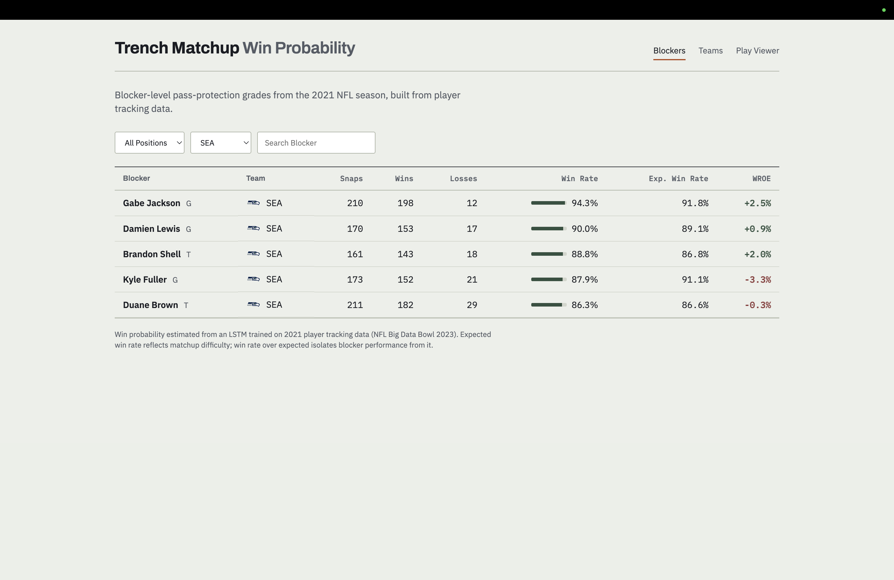
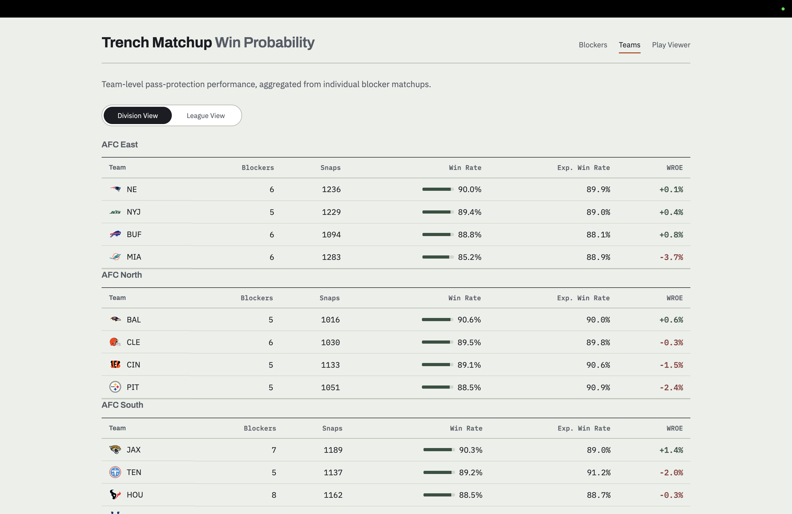
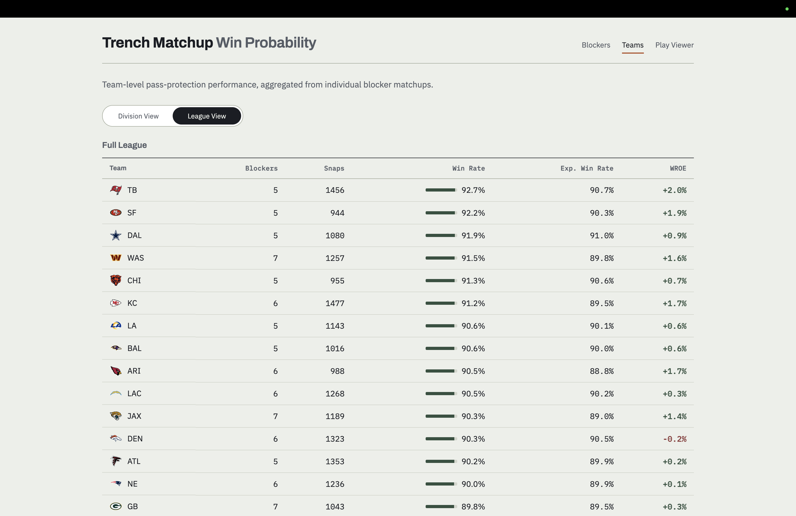
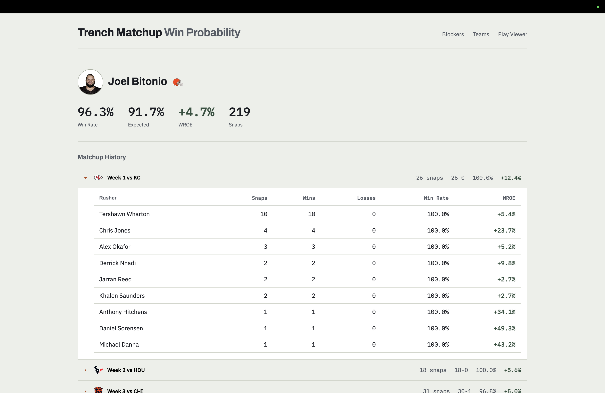

# Dashboard walkthrough

A tour of the interactive dashboard. The pages are plain HTML and JavaScript; see [`dashboard/README.md`](../dashboard/README.md) to run them locally.

## Blockers

Every qualifying blocker (80+ snaps), with win rate, expected win rate, and win rate over expected (WROE). Columns sort, and the table filters by position, team, or name.

## Filtering to a single team:

## Teams

Teams ranked within their division, or league-wide using the slider.

## Matchup detail

Click a blocker to see their season grouped by opponent and week. Expanding a week shows each rusher they faced, with win rate and WROE per matchup. WROE on a one- or two-snap matchup can look extreme because the sample is tiny; the blocker-level figures at the top are the ones to read.

## Play Viewer

A frame-by-frame replay of a single blocker-rusher matchup, with the model's win probability updating at every frame. Each replay shows the full formation with the matchup highlighted, and a probability curve that builds as the play unfolds. The page needs data that cannot be redistributed, so it does not work from a plain clone of this repository; running notebook 07 creates the necessary file.
