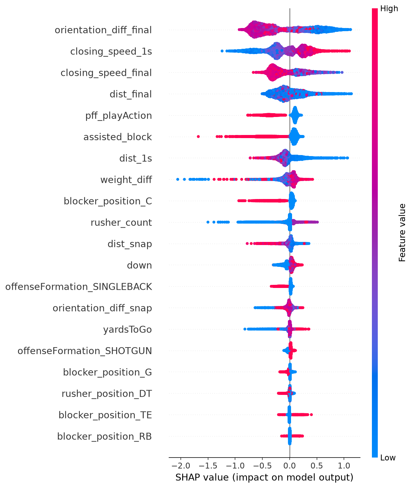
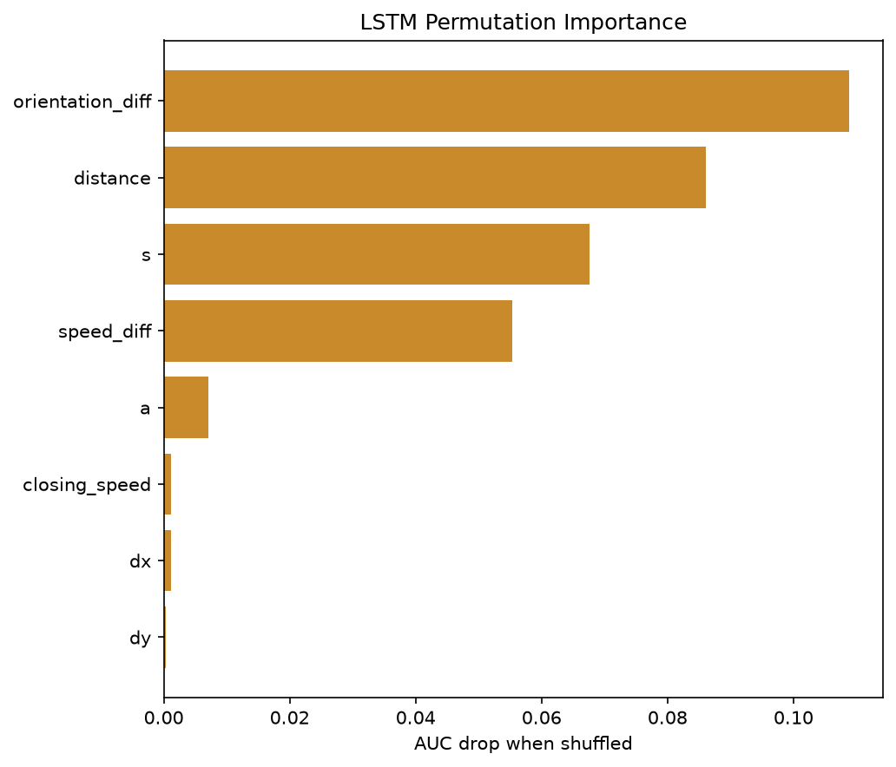
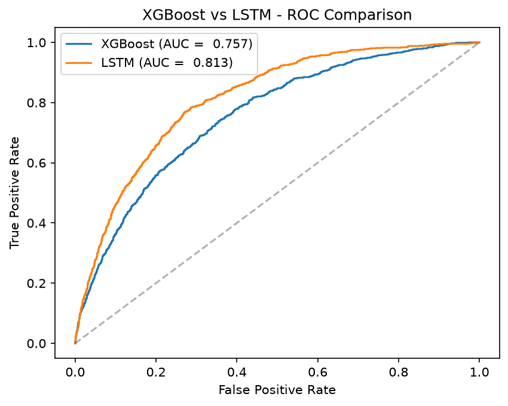
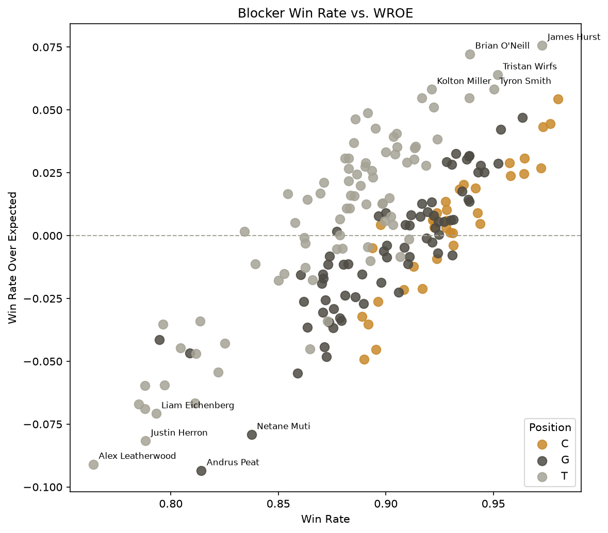
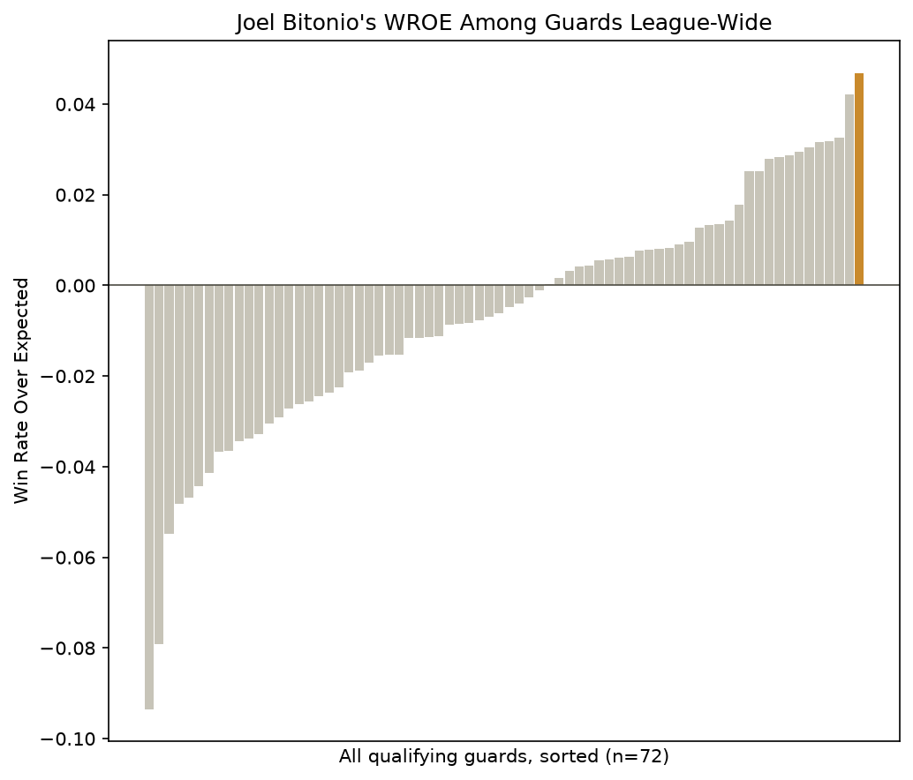

```{=latex}
\begin{titlepage}
\centering
\vspace*{\fill}
{\Huge\bfseries Trench Matchup Win Probability\par}
\vspace{0.5cm}
{\Large Modeling Pass-Block Outcomes from Player Tracking Data\par}
\vspace{1.5cm}
{\large Kyle Smith\par}
\vspace{0.5cm}
{\large 2026\par}
\vspace*{\fill}
\end{titlepage}
\clearpage

\setcounter{tocdepth}{1}
\hypersetup{linkcolor=black}
\tableofcontents
\clearpage
\hypersetup{linkcolor=blue}
```

\clearpage

# Introduction

Pass protection is one of the least directly measurable aspects of NFL offensive performance. Traditional charting captures the outcome of a block but discards the information contained in *how* that outcome unfolded: the blocker's positioning relative to the rusher, how that relationship evolved over the two to three seconds of a dropback, and whether a blocker who appeared to be losing a rep recovered or a blocker who appeared to be winning was beaten late.

This project asks a specific, testable question: does a model that observes the full frame-by-frame trajectory of a pass-block matchup predict its outcome more accurately than a model that only observes summary statistics of that same matchup at a few sampled instants? This is not merely a question of raw predictive accuracy. If a sequence model meaningfully outperforms a snapshot-based model on the same data, that result is itself evidence that pass-block outcomes are shaped by *trajectory* rather than its beginning and end states. That distinction has direct implications for how blocking performance should be measured and graded, which motivates the second half of this project: translating the better-performing model into blocker- and team-level metrics that isolate individual performance from matchup difficulty.

Two models were built on identical underlying data and compared on a shared, held-out test set: a gradient-boosted tree ensemble (XGBoost) trained on hand-engineered features sampled at three points in a blocking rep, and a long short-term memory network (LSTM) trained on the full, continuous frame-by-frame sequence. The comparison between them, not either model in isolation, is the central empirical contribution of this study.

\clearpage

# Data {#sec-data}

## Source

This project uses the NFL's 2023 Big Data Bowl release, the only public player-tracking dataset scoped specifically to offensive and defensive line pass-blocking matchups. The tracking data itself is provided by NFL Next Gen Stats; play-level blocking assignments, block types, and pressure/sack/hurry charting are provided by Pro Football Focus and distributed as part of the same release.

## Scope

The release covers the 2021 NFL season, weeks 1 through 8. This is a meaningful constraint as no full-season equivalent of this data publicly exists, and no newer season has been released with comparably scoped pass-block charting. Every result in this writeup therefore reflects an eight-week window of one season, not a full-season or multi-season sample. This is addressed further in @sec-limitations.

## Raw Tables

Four tables make up the raw release:

- **`games.csv`** - one row per game, giving season, week, and the two competing teams.
- **`plays.csv`** - one row per play, giving down, distance, formation, personnel coverage scheme, and the play's final result.
- **`players.csv`** - one row per player who appears anywhere in the tracking data, giving name, position, height, and weight.
- **`pffScoutingData.csv`** - one row per player per play, giving that player's role on the play (pass block, pass rush, coverage, passer, or route), block type where applicable, and PFF's charted pressure outcomes (hit, hurry, sack, and whether a blocking player was beaten without yielding one of those three).
- **`week1.csv` through `week8.csv`** - the tracking data itself: one row per player per tenth-of-a-second frame, giving position, speed, acceleration, orientation, and direction of motion.

## Ingestion

The tracking data begins as one row per player per frame per play, across all 22 players on the field, for every play within the scope. This is far more than is needed to study pass-block matchups specifically. The ingestion pipeline (`01_ingest.ipynb`) narrows this down in three steps.

**Play-level filtering.** Plays are restricted to those with a dropback outcome relevant to sustained pass protection (a complete/incomplete pass, sack, or interception). Plays with a denoted scramble are excluded, since a quarterback scramble typically means the pocket has broken down and blockers are no longer executing a clean pass set; a scramble is not a fair test of a blocking rep. This filter retained 94.8% of plays (8,108/8,557), yielding a minor, but necessary trimming. 

**Frame-window trimming.** For each retained play, tracking data is trimmed to the window between the `ball_snap` event and the earliest of `pass_forward`, `qb_sack`, `qb_strip_sack`, or `fumble`, the span during which a blocking rep is actually taking place. Plays that don't have `ball_snap` due to some tracking or data error are dropped, since no valid start point can be established for the play. This affected another small minority of plays. A week 1 spot check found only 3 plays violated this stipulation.

**Role and block-type scoping.** The trimmed tracking data is joined against `pffScoutingData.csv`, retaining 99.3% of the PFF-charted rows (186,902/188,254). Within this join, blocking assignments tagged `NB` ("no block") are dropped entirely, as they do not represent a real blocking attempt. Assignments tagged as switches, backfield help, post blocks, or chip blocks (any blocking rep where there is not a clean one-on-one rep for a player) are retained but flagged with a boolean `assisted_block` indicator. There are 336,721 such rows, so their getting dropped would be much more significant than the other trims. These assisted blocks represent shared or handed-off responsibility. This distinction is carried through the rest of the pipeline and is discussed further in @sec-limitations.

The result of ingestion is over five million frame-level tracking rows, scoped to legitimate pass-blocking reps across the eight-week window.

## Outcome Definition

A blocking rep is labeled a **loss** if PFF's charting credits the defender with a hit, a hurry, or a sack on that play, or if the blocker is charted as beaten by the defender without one of those three outcomes being separately recorded. Every other charted pass-block rep is labeled a **win**. This binary label is the target variable for both models described in @sec-xgboost and @sec-lstm.

\clearpage

# Feature Engineering and Scoping Decisions {#sec-features}

## Snapshot Feature Construction

For each retained blocking rep, the blocker's tracking row is paired with the tracking row of the specific defender PFF's charting identifies as the blocked player, using `pff_nflIdBlockedPlayer` as the join key. From this paired frame-by-frame data, `02_snapshot-features.ipynb` derives a set of features describing the geometric relationship between blocker and rusher at three points in the rep: the snap, approximately one second after the snap, and the final tracked frame before the outcome event.

At each of these three points, the following are computed:

- **Distance** between blocker and rusher (Euclidean, in yards)
- **Closing speed** - the change in that distance from the previous tracked frame, positive when the two players are converging
- **Orientation difference** - the absolute difference in each player's facing angle, in degrees

Two additional features are computed once per matchup rather than once per sampled point: **weight differential** and each player's **position**.

For blocking reps shorter than roughly one second, a fast sack or a very quick throw, the "one second in" and "final frame" snapshots can coincide, since there is no later frame to sample separately. This is a scoping limitation of the snapshot approach specifically and is discussed further in @sec-limitations; it does not affect the LSTM, which reads every available frame regardless of rep length.

## Thin-Category Collapsing

Two categorical fields, offensive formation and defensive coverage scheme, contain several categories with very few observations (e.g., Wildcat formation, or Prevent coverage). Categories representing less than roughly one percent of the sample were collapsed into a single `OTHER` bucket prior to modeling, to avoid the model overfitting to sparse categories with little generalizable signal. This threshold was a judgement call rather than a statistically derived cutoff, and is stated here as such.

## Exclusion of Coverage Variables

Defensive coverage scheme was included in an early version of the feature set and subsequently removed. Coverage scheme describes how the secondary is defending the pass downfield, which has no direct mechanical bearing on a specific blocker's matchup with a specific rusher in the trenches. Early feature-importance results supported this reasoning. Coverage variables consistently ranked among the least important features in the XGBoost model. They were dropped from the final feature set on the grounds that they added conceptual noise without a corresponding gain in predictive signal. Down, distance, and offensive formation were retained, as game situation plausibly affects pass-rush aggressiveness and pocket depth in a way that is more directly relevant to a blocking rep. Defensive coverage scheme offers no new necessary information to a pass block rep that other variables do not cover to some degree.

## Rusher Count and Blitz Flag

Two features were added after the initial feature set was built. **Rusher count** (the number of defenders tagged with a pass-rush role on the play) and a derived **blitz flag** (set when rusher count reaches five or more). The number of rushers changes blocking assignments and can force a blocker into a more difficult or unfamiliar matchup.

Adding rusher count produced a measurable improvement in model performance, consistent with this reasoning. The blitz flag, however, did not appear among the more important features once rusher count was already present as a continuous variable. This suggests the raw count captures the relevant information more efficiently than a binarized threshold of the same signal. Both were retained in the final feature set, but the finding appears that the continous count, not the binary flag, is doing the analytical work.

## Final Feature Set

| Category | Features |
|---|---|
| Geometry | distance, closing speed, orientation difference, weight differential (each at snap / ~1s / final frame) |
| Player & matchup | blocker position, rusher position, assisted-block flag, play-action flag |
| Situation | down, yards to go, offense formation, rusher count |

Table: Final XGBoost feature set, after all scoping decisions described
above. {#tbl-features}

\clearpage

# XGBoost {#sec-xgboost}

## Model

XGBoost, a gradient-boosted decision tree ensemble, was trained on the snapshot feature (@sec-features) to predict the binary win/loss outcome of a blocking rep. Trees are added sequentially, with each new tree trained to correct the residual errors of the ensemble built so far, producing a final prediction that is a weighted sum across several hundred individually shallow trees.

## Handling Class Imbalance

The outcome label is imbalanced: across the full retained sample, blocking reps result in a loss roughly 10.9% of the time. Left unweighted, a classifier trained on this distribution tends toward predicting the majority class (a win) by default, achieving high apparent accuracy while providing little practical value for identifying true losses.

XGBoost's `scale_pos_weight` parameter reweights the loss function to penalize misclassifying the minority class more heavily. Rather than setting this to the naive class-ratio value, a sensitivity sweep was run across a range of weight values, evaluating each on precision, recall, and F1.

| `scale_pos_weight` | AUC | Precision (loss) | Recall (loss) | F1 |
|---:|---:|---:|---:|---:|
| 5.0 | 0.759 | 0.280 | 0.465 | 0.350 |
| 5.5 | 0.758 | 0.270 | 0.509 | 0.353 |
| 6.0 | 0.759 | 0.260 | 0.546 | 0.352 |
| 6.5 | 0.759 | 0.246 | 0.565 | 0.343 |
| 7.0 | 0.758 | 0.241 | 0.600 | 0.343 |
| 7.5 | 0.757 | 0.232 | 0.617 | 0.337 |

F1 is nearly flat across this range, meaning no single value is clearly optimal on that basis alone. A value of 6.5 was selected deliberately over the strict F1-maximizing value, on the reasoning that this model's intended downstream use makes a missed loss (a false negative) costlier than a false alarm. This is a stated design choice, not a value derived purely from the data, and is revisited when the same weighting is carried into the LSTM.

## Hyperparameter Tuning

With `scale_pos_weight` fixed at 6.5, a grid search over tree depth, learning rate, and number of estimators was run via three-fold cross-validation, optimizing F1. The search selected `max_depth = 5`, `learning_rate = 0.05`, and `n_estimators = 200`, a modest refinement over untuned defaults. On the held-out test set, the tuned model achieved an AUC of 0.757, with 56% recall and 25% precision on the loss class.

## Interpretation

SHAP (SHapley Additive exPlanations) values were computed on the tuned model to attribute each prediction to its contributing features. The features with the largest average impact were `orientation_diff_final`, `closing_speed_1s`, `closing_speed_final`, and `dist_final` - the model relies most heavily on the *end state* of a blocking rep rather than its opening moments. A pattern worth noting directly, this model performs more retrospective grading of how a rep resolved than genuine early-rep prediction. `pff_playAction` and `assisted_block` showed the cleanest, most separable relationships with the predicted outcome among the remaining features. Rusher count and player position contributed more modestly. This feature-importance profile is compared directly against the LSTM's own interpretation results in @sec-comparison.

{#fig-xgb-shap width=50%}

As @fig-xgb-shap shows, final orientation difference and the closing speed features dominate the ranking, consistent with the model relying most heavily on the end state of the rep described above. 

\clearpage

# LSTM {#sec-lstm}

## Model

A Long Short-Term Memory (LSTM) network was trained on the same underlying matchups as the XGBoost model, but on a fundamentally different representation of the data: rather than the three sampled snapshots, the LSTM reads the full frame-by-frame sequence of a blocking rep, roughly ten frames per second from snap to outcome. At each frame, the network updates an internal hidden state that carries forward information from every prior frame, allowing it to represent patterns that summary statistics at fixed points cannot capture (e.g.,  a rusher who feints one direction before converting the other, or a blocker who is beaten early but recovers).

Each frame's input consists of eight features describing the blocker-rusher relationship at that instant: relative position (`dx`, `dy`), distance, closing speed, orientation difference, speed differential, and the blocker's own raw speed and acceleration. Sequences shorter than the maximum tracked lenght are handled via PyTorch's `pack_padded_sequence`, which passes each sequence's true length to the network so that the padded frames are mathematically excluded from computation entirely, rather than relying on a masking value that could be confused with a genuine near-zero measurement.

The same class-weighting decision from the XGBoost model was carried over and held fixed at 6.5, for the same stated reasoning: recall on true losses was prioritized over precision.

## Training Duration

Epoch count was validated directly rather than chosen arbitrarily. Two independent training runs were compared at both 20 and 35 epochs with model weights reset between runs to ensure a clean comparison. The clean comparison showed 20 epochs matched or slightly exceeded the 35-epoch run on every metric, with training loss still declining but with diminishing returns by that point. Twenty epochs was adopted as the final training duration on this basis. Reference @tbl-epochs.

| Epochs | AUC | Recall (loss) | Precision (loss) |
|---:|---:|---:|---:|
| 20 | 0.821 | 0.80 | 0.25 |
| 35 | 0.816 | 0.78 | 0.24 |

Table: Epoch-duration comparison, both runs freshly initialized. {#tbl-epochs}

Because model weights are not seeded, exact results vary modestly between otherwise-identical training runs; AUC on repreated 20-epoch runs ranged between 0.806 to 0.821. The version of the model used throughout the rest of this project achieved an AUC of 0.814 on its own test split.

## Interpretation

Unlike XGBoost, the LSTM has no exact per-prediction attribution method analogous to SHAP. Permutation importance wa used instead. Each of the eight input feature channels was independently shuffled across the test set, and the resulting drop in AUC was recorded, giving a measure of how much the model's performance depends on that specific channel.

{#fig-lstm-perm width=70%}

As @fig-lstm-perm shows, `orientation_diff` produces, by far, the largest AUC drop when shuffled, followed by `distance`, raw speed (`s`), and speed differential. Notably `closing_speed`, XGBoost's second most heavily relied upon metric, carries almost no independent importance here, nor do the raw directional components `dx` and `dy`. This divergence is discussed directly in @sec-comparison, where it is interpreted as evidence that the LSTM extracts motion information differently from continuous speed readings rather than needing the two-point closing speed approximation XGBoost was built to rely on.

\clearpage

# Model Comparison {#sec-comparison}

## Methodology 

XGBoost and the LSTM were trained on independently drawn train/test splits from two differently-structured underlying datasets (snapshot features versus sequence arrays), meaning the two models' own reported test-set metrics are not directly comparable on a row-for-row basis - the same seed and stratfication target do not guarantee the same rows land in each split when the underlying data structures differ. To produce a valid comparison, `05_model-comparison.ipynb` merges both models' predictions on their shared matchup identifiers, keeping only matchups present in both test sets, and asserts that both models' stated outcome labels agree on every shared row before proceeding. This is a verified precondition, not an assumption: the assertion passed on the full shared set with no mismatches, confirming the merge correctly aligned identical real-world matchups before any comparison was computed.

## Result

{#fig-roc width=60%}

As @fig-roc shows, the LSTM's curve sits above XGBoost's across nearly the entire range of the plot, not only at a single operating point, indicating that the LSTM ranks blocking outcomes more accurately regardless of how conservative a flagging threshold is chosen. On this shared test set, XGBoost achieved an AUC of 0.757 and the LSTM achieved 0.813. This corresponds to a gap of 0.056, which given the AUC range across repeated LSTM training runs (0.806-0.821, noted in @sec-lstm) represents a real and consistent advantage rather than noise from a single favorable run.

This result is the central empirical finding of this project. A model given access to the full trajectory of a blocking rep predicts its outcome meaningfully better than a model given only sampled snapshots of the same underlying geometry, despite both being trained on conceptually equivalent information.

## Where the Models Diverge

The two models' interpretation results (@fig-xgb-shap, @fig-lstm-perm) agree on the single most important signal, being orientation difference between blocker and rusher, but diverge on how each represents motion. XGBoost leans on `closing_speed_1s` and `closing_speed_final`, a two-point approximation of how quickly the players were converging. The LSTM, with continuous access to every frame's raw speed and acceleration, derives comparable information from `s` and `speed_diff` directly and shows almost no independent reliance on the closing-speed approximation. This is offered as a mechanistic explanation for the performance gap: the LSTM is not simply "seeing more data" in a generic sense, it is specifically able to substitute a richer, continuous motion signal for the coarser two-point estimate XGBoost was built to rely on.

## Calibration

Prior to any dashboard-facing use of either model's output, predicted probabilities were checked against the true outcome rate on the test set. The LSTM's raw predicted win probability averaged 71.6%, against a true win rate of 89.1% on the same set, a 17.5 percentage-point understatement. This is a direct consequence of the `scale_pos_weight` / `pos_weight` reweighting described in @sec-xgboost and @sec-lstm: reweighting a classifier's loss function to prioritize recall systematically distorts its raw predicted probabilities away from their true calibration, even though it does not affect ranking-based metrics such as AUC.

Platt scaling - fitting a single-feature logistic regression that maps each model's raw predicted probability onto the true outcome - was applied as a post-hoc correction. After calibration, the LSTM's average predicted win probability matched the true rate exactly (89.1% to three significant figures). This corrected probability, not the raw model output, is what is used throughout the dashboard and play-animator described in @sec-product and @sec-animator. The AUC, precision, and recall figures reported in @sec-xgboost, @sec-lstm, and above are based on uncalibrated model output, since calibration does not change a classifier's ranking of observations and therefore does not affect those metrics.

\clearpage

# From Model to Product {#sec-product}

## Full-Dataset Inference

The LSTM described in @sec-lstm was trained and evaluated on a 20-percent held-out test split - appropriate for reporting honest performance metrics, but a poor basis for a dashboard intended to reflect a blocker's actual season, since roughly 80% of any given player's real matchups would be entirely absent from a test-set-only view. To resolve this, the trained model (with weights held fixed, no retraining) was run in inference mode across the full season's 42,080 matchups, with the same Platt-scaling correction described previously applied to every prediction. This distinction is maintained deliberately throughout the project: the model's reported performance (AUC, precision, recall) is always based on the held-out test set alone; the dashboard's displayed statistics are based on full-dataset inference, which was never used to evaluate the model itself.

## Derived Metrics

Three figures are computed per blocker and displayed throughout the dashboard:

- **Win rate** - the blocker's actual share of clean reps, computed from real charted outcomes, not model predictions.
- **Expected win rate** - the average calibrated win probability the LSTM assigned across that blocker's matchups, reflecting the difficulty of who they actually faced.
- **Win rate over expected (WROE)** - the difference, isolating a blocker's own performance from the difficulty of their particular slate of matchups.

Team-level and blocker-level aggregates throughout the dashboard are snap-weighted, so that a blocker or team's figures are not distorted by treating a five-snap sample and a forty-snap sample as equally informative.

## Qualification Threshold

The landing view of the dashboard restricts displayed blockers to those with at least 80 charted snaps across the season. This threshold was set empirically rather than arbitrarily: the full-season snap-count distribution across 525 blockers is strongly bimodal, with a dense cluster of low-snap, rotational or partial-season players and a separate cluster of players with sustained, season-long playing time.Distribution analysis shows the point of minimum player density sitting between roughly 64 and 96 snaps. 

{#fig-snap-dist
width=65%}

As @fig-snap-dist shows, the distribution is clearly bimodal, with the
chosen cutoff sitting in the low-density region between the two
clusters rather than arbitrarily bisecting either one.

Eighty was selected as the cutoff within that empirical valley, rather than an arbitrary round number, excluding approximately two-thirds of the full blocker pool (337/525) while retaining the group that represents genuine, sustained starting-caliber playing time.

## Finding: The Model Infers Positional Matchup Difficulty {#sec-position-finding}

Blocker-level win rate and expected win rate were compared across the three offensive line positions (center, guard, tackle) among the 188 blockers meeting the snap-qualification threshold:

| Position | Win Rate | Expected Win Rate |
|---|---:|---:|
| Center | 93.0% | 92.6% |
| Guard | 90.1% | 90.7% |
| Tackle | 87.6% | 87.0% |

Tackles show the lowest raw win rate and the widest spread in individual outcomes; centers show the highest. Critically, **expected** win rate tracks this same ordering almost exactly, with a gap between tackle and center of roughly 5.5 percentage points on both the actual and expected side. 

{#fig-wroe-position width=65%}

As @fig-wroe-position shows, WROE remains small and centered near zero across all three positions even though raw win rate varies by more than five points between tackles and centers, a pattern only possible if expected win rate is already accounting for nearly all of that positional difference. Tackles do show the widest individual spread of any position, populating both the highest and lowest WROE values in the sample, consistent with facing a wider range of matchup difficulty (elite edge rushers against lesser ones) than the more uniform interior matchups guards and centers typically see.

The model was never given player position, or any direct label of matchup difficulty, as an input feature - it inferred, purely from tracking geometry, that tackles face systematically harder one-on-one pass rush assignments than guards or centers, consistent with tackles being the offensive line position most often left in true isolation against a defense's best individual pass rusher.

WROE itself is close to flat across positions (guard: -0.6%, center: +0.4%, tackle: +0.6%), meaning the metric is doing precisely the job it was designed to do: separating a real, model-detected difficulty gradient from individual blocker performance, rather than conflating the two. 

\clearpage

# Case Study: Joel Bitonio {#sec-case-study}

The positional finding described previously is best made concrete with a specific player. Among the 188 blockers meeting the snap-qualification threshold described in @sec-product, Cleveland Browns' All-World Guard, Joel Bitonio recorded the highest win rate over expected of any guard in the sample.

| Statistic | Value |
|---|---:|
| Win Rate | 96.3% |
| Expected Win Rate | 91.7% |
| WROE | +4.7% |
| League Rank (Guards) | **1st** of 72 |
| League Rank (All Players) | **11th** of 188 |

This result is notable specifically because of the positional context established in @sec-position-finding: guards average a slightly *negative* WROE league-wide (-0.6%), meaning the model expects most guards to perform marginally below their own difficulty-adjusted expectation. Bitonio's performance runs directly against that trend by a wide margin.

{#fig-bitonio-rank width=45%}

As @fig-bitonio-rank shows, most guards in the sample cluster within a few percentage points of zero WROE. The negative tail extends considerably further than the positive one, reaching nearly -9% at its lowest point, while Bitonio sits alone at the top of a much shorter positive tail. The gap between Bitonio and the next-highest guard is larger than the gap between any other two adjacent guards in the ranked distribution, indicating this is not a narrow, marginal distinction from the rest of the field, but a clear outlier result.

# The Play Animator {#sec-animator}

To make the LSTM's frame-by-frame reasoning inspectable rather than purely aggregate, a companion interactive view was built showing live, per-frame win probability alongside a rendered replay of the tracked formation. Because true incremental inference is computationally expensive relative to the single-pass inference used for the dashboard in @sec-product, this view is scoped to a curated selection of 50 matchups rather than the full season.

## Selection Methodology

Candidates were drawn from five categories (10 plays per), each selected by a different method:

1. **Confident wins**. The highest calibrated win probabilities among matchups with a matching real outcome, spread across center, guard, and tackle.

2. **Confident losses**. The lowest calibrated win probabilities (losses) among matchups with a matching real outcome, spread across center, guard, and tackle. 

3. **Name recognition plays**. A mix of high-snap-count blockers and matchups against a short list of well-known interior and edge rushers included for recognizable names in the viewer-facing output.

4. **Movement swings**. The largest snap-to-final change in distance and orientation, a geometric proxy for a visually dynamic rep, computed without running the model.

5. **Probability swings**. Rather than relying on the movement proxy above, true incremental win-probability curves were computed for a narrowed shortlist of 400 candidate plays (the highest movement score plays not already selected into another category), and the largest genuine probability ranges were selected. This category is distinct from the movement-based category above: a play can show large physical movement without a correspondingly large shift in the model's confidence, and vice versa.

## Presentation

Two adjustments were made specifically for this view, neither of which affects the underlying model or its reported metrics elsewhere in this document. First, each play's displayed win-probability curve begins with a synthetic frame set to 50%, representing the pre-snap moment before the model has processed any tracking data. Second, plays are normalized for display: each is individually zoomed to its own bounding box of player movement rather than the whole field, and mirrored where necessary so that the offense is always shown advancing in a single consistent visual direction.

\clearpage

# Limitations {#sec-limitations}

## Data Scope and Vintage

The dataset reflects a single season (2021) and an eight-week window within it. This is the only publicly available player-tracking dataset scoped to offensive and defensive line pass-block matchups as of this writing; no newer season has been released with comparable charting. Every result in this document should be read as describing that specific window, not a full season or a multi-season pattern.

## Ingestion

Approximately 0.3% of otherwise-valid plays in a spot-checked week lacked a detectable `ball_snap` event and were dropped for lack of a valid frame window (@sec-data). The snap-to-outcome window ends at the first of several tagged events; tracking anomalies around these event tags were not separately audited and could introduce minor imprecision in a small number of plays.

## Block-Type and Matchup Scoping

Blocking assignments tagged `SW` (switch), `PT` (post), `BH` (backfield help), `CH` (chip) represent shared or handed-off responsibility rather than a clean one-on-one rep. These were flagged with an `assisted_block` indicator rather than excluded (@sec-data), meaning the win/loss outcome for these rows may not belong entirely to the tagged blocker. Scrambles were excluded from the play population entirely, on the reasoning that a broken pocket is not a fair test of a blocking rep; this narrows the studied population to clean dropback plays only.

## Feature Scoping

Thin categories in offensive formation and defensive coverage were collapsed using a manually chosen frequency threshold (@sec-features) rather than a statistically derived one. Coverage-scheme variables were excluded from modeling on the reasoning that they are mechanically unrelated to an individual blocking matchup. This is a deliberate scoping choice, not a data limitation, but one that trades a potentially relevant signal for interpretability. The blitz-flag threshold (five or more rushers) is a conventional but not universally standardized definition.

The `dx` and `dy` input features (raw x- and y-axis separation between blocker and rusher) were computed in unadjusted field coordinates and were never normalized for play direction in either model's feature set. Because a play can run toward either end of the field, `dx` in particular does not consistently represent the same spatial relationship across different plays. This normalization was later built for the play animator's visual display (@sec-animator), but was never applied to the modeling features themselves. Permutation importance (@fig-lstm-perm) shows both features carry negligible weight in the LSTM's predictions, which is consistent with the model having learned not to rely on this inconsistent signal, but it remains a real gap in the engineered feature set rather than a corrected one.

## XGBoost

The snapshot approach's three sampled points can coincide for very short blocking reps (@sec-features), collapsing the "one second in" and "final frame" snapshots into the same frame. The model's most important features describe the end state of a rep rather than its opening moments (@sec-xgboost), meaning it performs more retrospective grading of how a block resolved than genuine early-rep prediction. The class-weighting value of 6.5 was a deliberate choice trading precision for recall, not a value that optimizes a single best metric, and hyperparameter tuning was a modest three-fold grid search rather than an exhaustive one.

## LSTM

Sequences were padded or truncated to the 95th-percentile observed length; the longest approximately 5% of blocking reps lose their tail frames. Model weights were not seeded, so results vary modestly between otherwise-identical training runs (@sec-lstm). Unlike XGBoost, the LSTM has no exact per-prediction attribution method; permutation importance estimates aggregate feature importance but does not explain any single prediction the way SHAP does, a real interpretability tradeoff in exchange for the model's stronger predictive performance.

## From Model to Product

The 80-snap qualification threshold (@sec-product) was set at an empirically observed valley in the snap-count distribution rather than derived from a formal statistical test, and it excludes any blocker below that count even if their limited sample happens to reflect real performance. Player headshots are matched to the dashboard's blocker list by name against a separate public dataset, since the two sources used incompatible player ID systems; nine of 188 blockers required a manual name-format correction, and a small number of players have no headshot on file in the source data at all.

## Play Animator

The animator covers a curated 50 of the season's 42,080 matchups, not full-season coverage, due to the computational cost of true incremental inference at scale. The "movement swing" and "probability swing" categories are related but distinct selection methods, and are not interchangeable despite both being informally described as showing a "dramatic" play. Each play's displayed line of scrimmage is approximated from the center's tracked position at the first real frame rather than an authoritative field maker, since no such marker exists in the source data at this granularity.

\clearpage

# Appendix {#sec-appendix}

## Repository Structure

The project repository is organized as follows:

```
trench-matchup-win-probability/
|-- nfl-big-data-bowl-2023/   # raw data (not included)
|-- notebooks/                # 01-07, the analysis pipeline
|-- processed/                # intermediate data (not included)
|-- models/                   # saved model weights
|-- figures/                  # charts used in this document
|-- dashboard/                # the interactive dashboard
|   `-- walkthrough/          # screenshot tour
|-- slides/                   # slide deck (PDF)
|-- writeup/                  # this document
|-- limitations.md
`-- README.md
```

Each notebook in `notebooks/` corresponds to one stage of the pipeline
described in this document:

- `01_ingest.ipynb` - @sec-data
- `02_snapshot-features.ipynb`- @sec-features
- `03_xgboost.ipynb` - @sec-xgboost
- `04_lstm.ipynb` - @sec-lstm
- `05_model-comparison.ipynb` - @sec-comparison
- `06_dashboard-export.ipynb` - @sec-product
- `07_play-animator.ipynb` - @sec-animator

## Data Availability

Per NFL Big Data Bowl 2023 competition terms, the raw tracking and scouting data is not redistributed in this repository. It is freely available to any participant directly from the competition's Kaggle page. Instructions for obtaining it are provided in the README.

## AI Usage Disclosure

Portions of this project's pipeline, dashboard, and supporting materials were developed with the assistance of Claude (Anthropic).

## Reproducibility

Random seeds were not fixed for LSTM weight initialization; exact metrics will vary modestly between reruns within the ranges reported in @sec-lstm. All other pipeline steps are deterministic given the same input data.